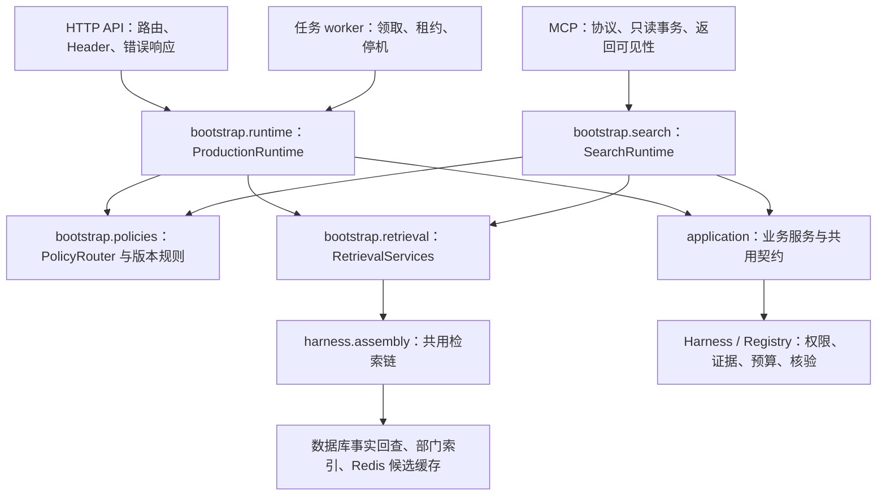

# 生产装配与导入边界

更新：2026-10-11。ARCH-08 的实现、自审核和限制见[记录 182](reviews/2026-10-11-implementation-182-shared-composition-and-import-boundaries.md)。本页描述当前模块职责；工程回归通过不代表模型质量、容量或生产发布通过。

## 1. 三个入口如何共用执行规则

共用的是装配规则与进程内资源责任。API、worker、MCP 仍是独立进程，各自拥有模型推理进程、配置缓存和必要连接；不是跨进程共享一个 Python 对象。Redis 缓存继续按照既有 namespace/版本/部门及失效规则共享。

| 模块 | 责任 | 不由该模块处理的内容 |
| --- | --- | --- |
| [application/contracts.py](../src/medops/application/contracts.py) | Ask、Task、反馈、回放、管理及受限材料的共享命令/结果模型，字段校验与 Schema | HTTP 路由、Header、状态码、鉴权中间件 |
| [infrastructure/identity.py](../src/medops/infrastructure/identity.py) | JWT/JWKS、HMAC 假名、目录查询、服务端身份构建 | 从请求正文接受部门、绕过未知/停用主体的拒绝 |
| [bootstrap/identity.py](../src/medops/bootstrap/identity.py) | 根据 Settings 装配身份适配器 | 在启动时向模型发送请求 |
| [bootstrap/connections.py](../src/medops/bootstrap/connections.py) | 统一连接/SQL 超时与数据库故障的安全错误类型 | 自动切换角色、扩大数据库权限 |
| [bootstrap/policies.py](../src/medops/bootstrap/policies.py) | 发布指针的有限 TTL 缓存、按主体灰度、共用 VersionSet 计算 | 将仓库最新文本当已发布策略、自动批准生产候选 |
| [bootstrap/retrieval.py](../src/medops/bootstrap/retrieval.py) | 按同一策略组装 BM25/向量/RRF/重排、术语、翻译、来源约束及缓存；共用实际配置绑定 | 自行选择用户身份、开启管理事务、把缓存候选当事实 |
| [bootstrap/runtime.py](../src/medops/bootstrap/runtime.py) | API/worker 的进程服务及请求依赖，连接角色、审计适配器、Registry/Harness 装配 | HTTP 路由声明、worker 轮询循环 |
| [bootstrap/search.py](../src/medops/bootstrap/search.py) | 只读搜索的每次执行、有限期限、独立计量、翻译网关的有界初始化/关闭 | MCP SDK 协议、替代只读角色和最终可见性检查 |
| [application/search.py](../src/medops/application/search.py) | 搜索执行的协议与结果，包括失败时的模型计量和实际版本 | MCP/HTTP 响应格式 |
| [knowledge](../src/medops/knowledge/) | PDF 原始页文本、norm-v1、PII 规则 | 评测打分、候选冻结、入库授权 |

## 2. 配置与安全的一致性

1. **身份和事务**：API 与 worker 用服务端目录构造身份；MCP HTTP 使用同一鉴权实现，stdio 仍只允许开发合成身份。生产搜索保持只读 DSN；审计仍在应用角色连接写入。检索只能使用入口已经绑定部门的事务；共用装配拒绝不同身份复用该事务。
2. **策略和版本**：`PolicyRouter` 读取发布状态，按主体选择同一个灰度结果，`request_policies()` 对该结果计算版本。历史 `policy-m3-api-1` 名称继续保持。输入策略有相同内容时，三个入口有相同检索版本、模型配置版本及相应缓存键；MCP 搜索 Trace 也记录完整的实际 VersionSet。进程间 TTL 缓存仍可在既有 TTL 内看到不同发布快照，没有新增跨进程强一致承诺。
3. **日期和归档**：Ask/Skill 使用 `QueryContext`。MCP 协议仍接受文档版本，由 service 解析为日期后，搜索装配同样使用 `QueryContext`。日期在一个执行内固定；普通查询与显式历史查询保持区分。缺少日期的历史搜索在模型/检索前拒绝。
4. **模型、预算和回执**：作答/判定默认模型、翻译允许名单均不变。生产模型网关都要求实际执行预算；翻译与所属执行使用独立计量器及共享预算。MCP 搜索保留 retrieve 节点的期限；装配前后与检索返回后检查截止时间，不能仅用 Token/费用检查代替时间检查。持久费用账本和调用回执仍由现有网关结算。
5. **缓存**：共用构造器仍使用实际检索版本和策略版本组成 cache_versions。缓存命中继续回查事实、ACL 和有效期；没有添加答案缓存。失效 worker 与常驻监督仍有后续部署任务。
6. **资源**：一个进程的装配服务缓存对应输出数量的重排包装器及验证过的术语表；懒创建网关使用锁。初始化失败和 MCP 服务构造失败会关闭已拥有资源。重排底层 scorer 的完整共享/singleflight 验收仍属于 ARCH-10，不能据包装器缓存宣布它完成。

## 3. 代码迁移与兼容范围

| 原 Python 模块 | 规范位置 |
| --- | --- |
| `medops.api.contracts` | `medops.application.contracts`；HTTP 幂等 Header 在 `medops.api.headers` |
| `medops.api.auth` | `medops.infrastructure.identity`；Settings 装配在 `medops.bootstrap.identity` |
| `medops.api.runtime` | `medops.bootstrap.runtime`；策略/检索/连接职责分别在相邻模块 |
| `medops.evals.probe.pii` | `medops.knowledge.pii` |
| `medops.retrieval.lexical.normalization` | `medops.knowledge.normalization` |
| probe 提取器的通用解析函数/参数 | `medops.knowledge.pdf`；评测写页和 CLI 留在 `medops.evals.probe.extract` |
| `medops.mcp.service.SearchExecution/Searcher` | `medops.application.search` |

仓库调用方直接使用规范模块，不保留转发壳。外部 Python 脚本若依赖旧内部导入，需要按上表迁移；这不是 HTTP/MCP 对外 Schema 变更。类字段、拒绝原因、接口状态和规范化/抽取/PII 版本保持原规则；Schema 导出通过字节检查。迁移历史文档的本地源码链接仅更新目标路径，历史叙述和原话不改写。

以下命令保留：`python -m medops.api.serve`、`python -m medops.worker.serve`、`python -m medops.mcp.serve`、`python -m medops.evals.probe.extract`。它们的 `--help` 可无模型费用验证；不表示已启动生产服务。

## 4. 自动导入边界检查

执行 `make architecture-check`，也由 `make check` 执行。实现见 [check_architecture.py](../scripts/check_architecture.py)，反例见 [test_architecture_boundaries.py](../tests/unit/docs/test_architecture_boundaries.py)。

检查遍历所有生产 Python AST，包括局部与 TYPE_CHECKING 导入、相对导入、`from medops import api`、字面量动态导入及常见别名。受约束包中的非字面量动态导入拒绝；允许项按精确模块边记录理由，失效允许项同样报错。

| 来源 | 禁止的主要依赖 |
| --- | --- |
| application / infrastructure / ingestion | API、MCP、worker、bootstrap、evals 和协议框架 |
| knowledge | 业务、入口、bootstrap、评测、入库、基础设施和检索包；可用 core 的共用工具 |
| bootstrap | API/MCP/worker、evals 和协议框架 |
| worker | API/MCP 和 evals，下面精确允许项除外 |
| API / MCP | 对方入口、worker、evals |

两条精确允许边都来自 `worker.observability` 的 `evals.telemetry`/`events_from_run`：运维 `--run` 明确导入冻结评测分数，先校验绑定再排入评分队列；不是实时问答装配依赖。没有目录通配例外。

该检查保证已声明的静态导入约束。它没有宣称整个项目满足严格的洋葱架构，也不证明任意反射或运行时代码均可静态分析。业务执行继续保留必要的 Harness、预算、数据库适配和政策规则依赖；实验专属适配器迁出、评测工具打包、夹具归一分别由 CODE-04/05/06 继续处理。

## 5. 共享重排权重与输出视图

ARCH-10工程自审见[记录185](reviews/2026-10-11-implementation-185-shared-reranker-scorer.md)。一个InferenceProcess只在启动时初始化一个scorer，所有score请求在子进程主线程串行复用。RerankerView将冻结输出spec与模型分开；配置从8改4/5/12/20或回切不会重新加载CrossEncoder，取前N仍由父进程的rerank_evidence/检索链控制。

RetrievalServices用既有RLock为同输出视图提供singleflight；失败不入缓存，坏输出拒绝。视图只持有scorer/spec，没有自己的权重、队列或正文缓存。模型/框架/分数与版本规则不改：策略输出不同仍使用原检索版本/Redis缓存绑定；共同scorer不合并不同主体的事实授权。

这是一个runtime/lane内的复用。API、worker、MCP仍独立持有各自lane，不跨device、revision、owner共用权重；没有引入独立推理服务。原背压、期限和回收不变；lane超时/崩溃后所有视图失败关闭，由监督重启。

真实CPU离线4合成文本/8并发请求核对：加载1次、分数差0、参数与RSS计数、主线程推理、关闭回收通过。此证据不代表整套API时延、总体内存下降百分比或MPS容量收益；这些限制在记录185逐项披露。

## 6. 尚未交付的能力

MCP受限完整输入/逐模型正文已由CODE-07补齐，见[执行审计](MCP_EXECUTION_AUDIT.md)与记录194；Task/MCP执行回放仍未交付，ARCH-07的Ask诊断回放没有原条件恢复能力。反馈稳定身份已由ARCH-09/记录183完成。ARCH-14的必需服务/真实容器门已由记录190及后续CI实际验证，不能仍写远端未运行；长期部署和资源/容量仍待IDX-03/DEPLOY-02。

本轮不会激活候选、提交/推送或重启服务，不修改冻结题目/gold、默认模型、生产批准或验收阈值。S2 Agent、S3 模型驱动自进化、盲测与正式付费运行仍按[当前任务台账](CURRENT_TASKS.md)逐项推进。

## ARCH-13 部署监督边界

常驻入口/资源、容器词表与KEK、评分卷、进展心跳及定时维护见[部署契约](DEPLOYMENT_WORKERS.md)和[记录186](reviews/2026-10-11-implementation-186-worker-deployment-and-supervision.md)。单运行时模型共享不等于跨服务共享；Docker故障恢复与全量2136/70是工程证据，不替代长期部署、目标容量或医学质量。required CI工程门见[CI契约](CI_GATES.md)与[记录187](reviews/2026-10-11-implementation-187-required-ci-and-container-gates.md)：全量2157/70、真实BGE/private网络200→503；远端CI工程门已由记录190及后续实际验证，基线8361d8d的CI38193674785全部29步通过；amd64冷构建和业务容量仍待验证。

## ARCH-16 跨连接权限边界

[记录197](reviews/2026-10-12-implementation-197-architecture-authorization-review.md)检查并修复MCP事实连接旧快照/错误角色和管理接口鉴权后撤权。api.authorization仅管理协议会话，bootstrap.runtime负责同库/当前身份/提交栅栏装配，基础数据库模块提供RC/RLS和读写锁；没有把数据库实现塞进业务路由。ApiRuntime显式声明灰度观察窗口和drill能力。20新增反例、229定向、2296/70全量及326模块0静态违例通过；不等于动态Agent、正式质量或实际部署完成。剩余冗余/测试供给分别CODE-03/06。
