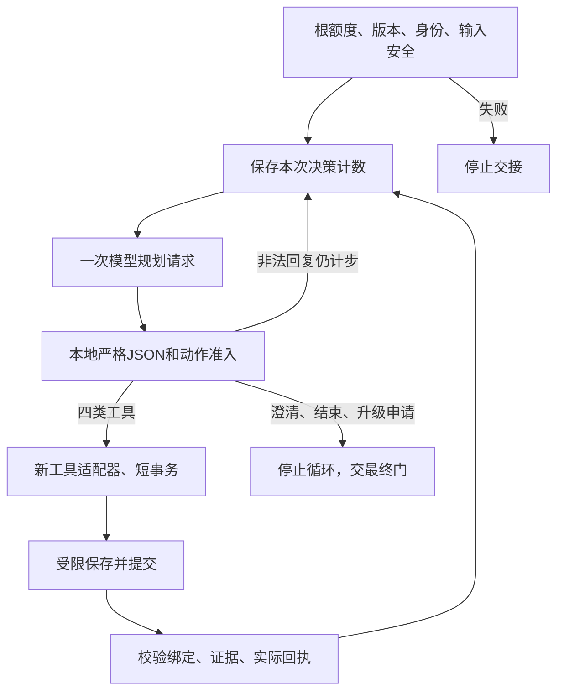

# AGENT-03：模型选择动作的内部循环

2026-10-15；依据已批准的[PLAN-02](PLAN-02-action-budget-and-acceptance.md)、[ADR-0012](../adr/ADR-0012-agent-evolution-goals-and-acceptance.md)，主切片AGENT-03。实现与自审核：Codex，不是第二独立人工；证据见[记录209](../reviews/2026-10-15-implementation-209-model-selected-agent-loop.md)。

## 1. 本轮可运行范围

`AgentLoop`已实现“构造规划输入→调用ModelGateway→严格解析一个动作→调用原工具→接收已提交观察→再次调用规划模型”。七个动作沿用[AGENT-01](AGENT_CONTRACTS.md)，四个工具沿用[AGENT-02](AGENT_TOOLS.md)。生产代码没有按PV-S0编号、query关键词或预设业务流程选择动作；除准入/故障/终态边界外，下一动作来自网关返回的JSON。

这轮提供内部控制器与必须实现的Driver接口，没有生产Driver、公共HTTP/MCP路由、持久恢复或最终业务完成门。测试中的Driver/事实库/模型均为明确的公开内存fake；实际复用Registry/引用Verifier/检索端口/AE Skill/共享MeteredGateway。**动态循环机制通过工程验证；真实规划质量和成本/时延尚未测量。**



图中的循环每次由模型提出动作，最多八次决策；服务端不替模型编写补检索/邻块路径。现有LangGraph问答图及内部Harness约束保持，新增循环以顺序控制器组织当前七动作，不引入新编排依赖；checkpoint技术选型LG-01仍选做，不能替代真实持久恢复。

## 2. 文件职责

| 文件 | 职责 |
| --- | --- |
| [agent_loop.py](../../src/medops/application/agent_loop.py) | 单次、顺序、模型驱动控制器，计步、准入、调用及停止交接；不发布completed |
| [agent_planning.py](../../src/medops/application/agent_planning.py) | 真实SYSTEM内容、内容SHA、明确PlannerConfig与PlanningBoard输入投影；不读取评分期望 |
| [agent_loop_ports.py](../../src/medops/application/agent_loop_ports.py) | 必需AgentLoopDriver、受限LoopCheckpoint和AgentLoopResult；没有无操作默认实现 |
| [agent_loop_validation.py](../../src/medops/application/agent_loop_validation.py) | 工具信封/句柄/来源/区间/原文摘录/逐claim核验结果的一致性检查 |
| [money.py](../../src/medops/core/money.py) | 统一USD到整数微USD的向上取整；原AgentTools同一函数体迁移后复用，不改变费用口径 |

应用层不导入evals、具体Skill实现、MCP或bootstrap；仍通过原Registry边界使用Skill。没有新增依赖、迁移、GRANT、公开Schema或已发布配置变化。

## 3. 首次调用与每个决策

调用方必须已认证并提供全新`PVAgentRun`、已有根execution_scope和MeteredGateway、显式PlannerConfig、可信Driver。没有父预算/期限就停止；不能重开额度。模型ID须在原价格表准入，max_output_tokens（1～4096）和timeout_s（1～125秒）必须显式给定，严格整数，不接受bool；不注册新默认模型。

全新运行要求running、0步、零预算快照，实际父额度也不能已经消费/挂预留；旧/已开始运行或Prompt内容摘要不匹配明确拒绝恢复。非running快照直接拒绝。工具契约内容摘要在第一次规划前与实际工具/Skill契约核对，不等付费规划后再发现不兼容。拒绝恢复时保留输入快照的原费用/预留；只有全新运行与零消费父额度都通过才绑定预算，不能把别的父执行费用抄进新run。真正恢复原期限/原预留/原计数仍属AGENT-04。

每次决策：

1. 检查根deadline/共享预算、继承的调用持有权guard、Driver的当前身份/条件和全部已登记证据；Driver结束所有读事务后返回。
2. 服务端生成decision_id，计数加一，调用`decision_started`同步checkpoint。Driver须以run/attempt和预期revision原子消费此步；保存失败不调用模型。
3. 构建真实ModelRequest并按原UTF-8保守预检算最坏用量，检查规划调用加最终核验预留能否容纳；不足不进供应商，留下拒绝交接。
4. 每步最多一个逻辑`agent_plan`请求，通过同一个MeteredGateway；run/attempt/decision真实关联。原网关的兼容性物理attempt由原call_journal记录，没有新增无限重试层。
5. 保存`planning_returned`、实际回复和本次回执ID，用响应text作唯一准入输入；不信任parsed字段绕过原文。截断/坏JSON/重复字段/额外scopes/未知动作/非法句柄均不执行工具；下一次修正也是新决策，计步计费用。
6. 工具动作交Driver使用新AgentTools实例执行；Driver须在事实/身份栅栏下保存受限结果及审计并commit，再返回。下一模型调用不可持有前一事务/栅栏。
7. 控制器复查输出绑定/原文/句柄及本次真实meter回执集合和action身份，保存`tool_committed`，才允许结果进入PlanningBoard。

`admission_run.decisions_consumed`是本次之前的计数，供原admit_action和AgentTools验证decision_index=prior+1；真实controller/checkpoint计数已经加一，不回退。这个只读准入视图不能持久化覆盖当前已消费步数。最多八决策，失败/非法/terminal申请都占步。

`LoopCheckpoint.request`是构建时的预检请求；MeteredGateway.call_journal保留实际缩短后的timeout、SDK参数及供应商attempt。两者分别保存，不宣称哈希等于HTTP wire bytes。完整持久化接线/重启追溯由AGENT-06完成。

## 4. 模型能看到什么

两个消息角色：SYSTEM是真实固定Prompt；user是canonical JSON结构化数据。叙述、来源和检索正文始终是数据，不作为新system指令。

可见字段包括原叙述/source_type、需求及说明、用户所问来源/版本及解析状态、允许文档ID/版本、QueryContext日期/历史模式、允许澄清字段、计数和预算、原文提取结果、可见证据、逐claim核验，以及上次动作名/kind。没有private gold、expected终态、评测结论、principal/scopes、case/task管理凭据、事实库身份或完整受限审计。原字段有条件/数字/否定就按原文保留，不生成事实来补知识缺口。

- 提取结果明确标`extracted_unverified`，不是最终语义或业务判断。
- 最多64个句柄元数据；只携带最近8份证据正文，旧的仍有handle/citation且明示`text_omitted_from_planning=true`，可由模型申请read。已读长片段不会被同句柄的后续短搜索摘录覆盖。
- 原工具500字符搜索摘录/8,000字符read及truncated标记保持；不会偷偷截断已读条件来让预算通过。超长规划由真实预算预检拒绝，不自动扩额。
- 最多32个不同claim检查，按requirement/text/handle集合关联；超限停止，不能静默删掉必需条件。核验结果仍名为`claim_checks_not_final_completion`。
- 失败/unsupported的payload不进入知识状态。新句柄来源/版本/PDF摘要、原引用/原文摘要/Unicode前缀和truncated必须一致；非法信封、错action、伪造回执或额外未展示的新句柄立即停止。
- 进入每次规划及其实际调用前，Driver再次核验所有登记证据和主体，撤权或事实改变后旧正文不再被交给模型。这里定义强制Driver契约；真实部署的DB短事务实现仍待后续。

## 5. JSON格式与预算的取舍

继续使用原闭合PlannerProposal/admit_action验证七动作。当前ModelRequest不附供应商json_schema，SYSTEM给出紧凑JSON字段规范，回复在本地强制校验；没有正则修补、执行代码或放宽额外字段。原完整Pydantic schema在本基线为6,115 UTF-8字节；现有根预算把schema字节计入保守预检，在12,000上限下会额外占用大量准入空间。省去重复传输完整schema并不取消服务端校验。

这是当前内部planner的传输选择，不改变原Skill/QA structured-output配置，不声称真实模型输出有效率已验证。真实坏格式/截断率、需要的输出上限、实际完成率由获准试跑测量；若要变格式/profile另行版本化。初始Prompt是真实内容和SHA，不是空版本标签；后续模型生成Prompt候选仍归EVOL任务。

12,000 input+output / 600,000微USD / 125秒总限额及原子调用预留继续由现有root budget约束。**记录211将最终预留保护接到共享调用准入，覆盖规划及工具内模型调用；工具整体估计、实际最终核验profile/消费与持久取消/租约/原预算恢复仍待。** 测试的512输出Token、20秒调用、1,000 Token/50,000微USD预留是合成显式配置，不是批准的生产默认值，不能据此启动托管实验。

### 5.1 连续重复与无进展（记录210）

按批准profile的`same_no_progress_limit=2`，只比较已校验且工具已提交的观察；决策开始、调用回执、工具结果保存规则保持。四类工具的规范化参数与稳定结果连续相同两次时，第二次结果保存后立即交接`no_progress`，不为该重复序列再发下一次规划/工具调用。不是按固定业务路径代替模型选工具，也不根据规划者自报的“新增信息”判断。

| 内容 | 比较规则 |
| --- | --- |
| 参数 | 保留工具名、AE叙述引用/来源类型、查询实际内容、读取目标/区域、核验claim及逐claim证据。忽略rationale、动作UUID、决策序号 |
| 查询展示差异 | Unicode NFC、全角ASCII、空白及明确列出的常见语句标点归一；保留大小写、数值小数/数字间逗号、正负号、比较符号、单位、否定、编号内部标点。不是语义同义词判定 |
| 句柄 | 将临时UUID解析成来源PDF SHA、完整citation（文档/版本/生效日/页/节/chunk）、正文SHA、chunk内容SHA、active/archived及historical的稳定摘要；到期时间与新UUID不算新事实。原实时ACL/期限/绑定校验仍在前面执行 |
| 检索/读取 | 比较实际返回区间、前缀正文SHA、是否截断及证据身份；顺序和重复副本不算新增。相邻块、更长原文或真实内容变化会改变结果摘要 |
| 提取 | 比较已对齐原文的要素（值/quote/偏移/kind）、缺失字段与Skill状态；丢弃/因果过滤计数不充当新事实。提取仍是未最终核验的业务材料 |
| 引用核验 | 比较requirement、claim原文、verdict、requested/supporting/unconfirmed证据及核验器版本；支持结果改变会结束旧连续序列 |
| 非ok结果 | 只比较固定kind；失败/不支持payload不成为新知识。dependency/timeout/budget/cancel/lease仍立即按原故障原因停止 |

`AgentProgress`仅保留上一组参数/结果SHA与连续次数，空间固定；`ProgressCheckpoint.version=pv-progress-v1`写入每个内部LoopCheckpoint，供可信Driver与同一步结果一起保存。尚未绑定本执行预算时，progress=None表示保留旧存储状态，不写新零值；旧执行/外来预算拒绝不会清零原重复次数。Checkpoint只增加摘要元数据，不改变36个已有公开Schema、Prompt或工具契约。没有生产Driver，当前不具备真实持久恢复；未来恢复必须连同预算、步骤、原截止、身份/租约和规划状态一起一致恢复该连续状态，不能在恢复时清零。

合法新信息继续：同query第一次empty、第二次获得证据，可以进入第三次规划；搜索后补读完整原文会改变动作/结果，重复相同完整读取才停止。真正改写query是新参数，即使结果相同也不在这条连续相同规则内；仍受8步/总预算/绝对期限限制。非法规划没有可执行动作，打断这段工具连续序列，照旧占决策步；不是免费重试。摘要变化仅表示没有连续重复，不证明改善或最终完成。非连续循环及一般语义等价不作该检测器的能力声明。

`no_progress`是受限交接原因，不直接把run标成escalated或completed；完整终态仍需AGENT-05/06保存。当前取消/失租/撤权及审计失败优先，重复检测不能把它们伪装为业务无答案。没有新增模型判定、模型费用或额外重试。

### 5.2 共享预算的最终核验预留（记录211）

`BudgetProtection`是根`ExecutionBudget`上不可被普通调用消耗的Token/费用空间。由已绑定本执行的可信循环安装，并由AgentTools再次保证；嵌套Registry、翻译线程、MeteredGateway和BudgetedGateway复用同一预算对象。每个进入原预算网关的调用用真实ModelRequest的UTF-8/schema/最大输出与锁定价目表预检，准入在同一锁内同时比较两维：

```text
已入账（已知或保守） + 当前在途预留 + 最终核验保护 + 本次请求保守预检量 <= 原执行上限
```

保护在同一根预算上只可逐维增大，重复安装取max，不叠加两份；退出scope、线程复制上下文或子Skill重新进入执行scope均不能清除。没有给子工具新发12,000 Token/0.60 USD，也不通过假调用占用月账本。`BudgetSnapshot.protected_tokens/protected_cost_usd`独立于accounted/known/reserved；AgentBudget的四个旧字段继续只表示真实已入账和待结算调用，不能把保护空间计成费用或供应商usage。

调用拒绝发生在供应商和月度预留前，仍生成原零费用denied回执；预算拒绝锁存，QueryTranslator即使按旧策略捕获异常并做普通检索fallback，工具最终预算检查仍失败关闭。原Skill重试共享同一保护，unknown usage继续保守入账；真实报告意外侵占保护时保留全部真实usage/费用、阻止输出及后续调用。保护为零的旧Ask/Skill路径保留原结算行为。

LoopCheckpoint附带本执行的实际`budget_protection`；旧执行、外来已花费/已预留/已保护预算在绑定前拒绝，字段None要求保留旧记录。初始预算保护不是持久存储、恢复签名或新授权；当前仍没有生产Driver。

兼容变化明确登记：预算组件为`execution-budget-v2+utf8-preflight+protected-headroom`，工具为`pv-tools-v2+protected-headroom`；工具契约SHA新增绑定实际预算组件版本。旧工具摘要的context在首次规划/工具调用前失败关闭，不以旧标签运行新保护。SYSTEM内容、默认模型、价格、根Token/费用/截止/八步与已有36个Schema均不改变。新摘要和旧摘要见记录211的机器回执；不是更新已发布策略指针。

预留数值继续来自显式AgentProfile；测试1,000 Token/50,000微USD是既有合成配置，不是新生产默认值。本轮没有推导实际最终核验器所需数值，也没有整项工具开始前的最大总调用估计；每个真实模型请求的调用准入保护已实现。实际核验profile/整体估计与可信最终阶段消费还需后续接线。本轮不提供解除保护接口，不能退出scope后任意花掉预留，更不能另开预算冒充最终核验。

## 6. 停止与最终门

finish/clarify/escalate均立即结束本循环，无新工具或模型调用。`AgentLoopResult.terminal_request`是待处理的BoundAction，run依然running且terminal=None；reason="completed"只表达finish申请的原因，**不是成功判决**。最终证据/完整性/业务/安全/当前授权/预算/持有权及原子材料保存必须由AGENT-05/06的可信终态方完成。

dependency_error、timeout、budget_exceeded、cancelled、lease_lost工具结果立即交接，不换成empty或正确无答案。Driver检查/checkpoint异常停止；保存失败统一audit_failure，不返回待完成材料。错误日志只记异常类型和最内层帧位置，不记录异常消息；Meter保留失败/取消/未知usage和保守费用。KeyboardInterrupt等BaseException传播到根执行者，不能当正常回答；实际取消收束/持久状态仍AGENT-04。

控制器一个实例只供一次同步调用；并发持有权/重启恢复要由真实Driver与AGENT-04保证。没有默认生产Driver，不能把测试MemoryLoopDriver接到服务中代替事务、权限、审计或费用批准。

## 7. 验证、限制与下一步

可零费用复现：

```sh
PYTHONPATH=src env -u DEBUG venv/bin/python -m pytest -q \
  tests/unit/application/test_agent_loop.py \
  tests/unit/application/test_agent_planning.py \
  tests/unit/application/test_agent_progress.py \
  tests/unit/application/test_agent_loop_progress.py
```

自适应假网关读取真实下一次规划消息，依据实际观察返回不同JSON；控制器使用同一个真实ModelRequest/MeteredGateway路径。验证正常search→verify→finish申请、empty→改query、部分证据→邻块读取、ambiguous→clarify、AE Skill及规划共额度等。反例验证非法/截断回复计步、八步终止、前置安全/版本/预算、保存失败、来源/句柄/正文/回执篡改、撤权、超时、未知费用及元数据遥测；不作为真实医学质量或正式Agent benchmark。

连续重复检查见记录210；共享调用保护见记录211；真实Driver/工具整体估计/实际核验profile与消费/持久取消及原预算恢复仍AGENT-04，完整最终门AGENT-05，受限持久追溯AGENT-06；最小SESSION仍S2前置，AGENT-07整体验证后才可AGENT-08获准付费试跑。EVAL-33真实独立保管、新盲测及原生产采用门继续独立，不因本轮循环实现而关闭。
