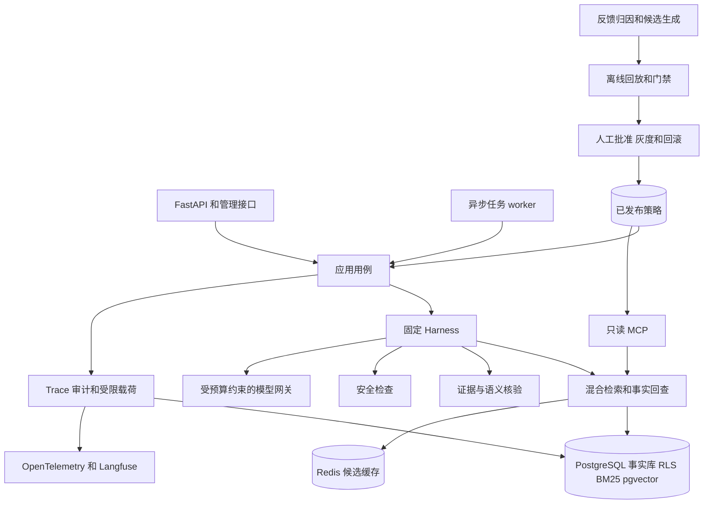

# Medy 全项目架构审查

日期：2026-10-10。审查基准：`5a604050b9c0706bfd823685e5befcb9619d64a6`。结果与复现数据见[审查证据](2026-10-10-architecture-audit-results.json)。

## 1 总体结论

项目已经具备可持续迭代的模块化单体结构，在数据库权限、文档治理、事实回查、策略发布和实验留证方面有较完整的工程基础。它适合继续沿当前架构完善。

目前只能评价为**架构基础较好，关键链路尚未全部可靠闭合**。单次请求的正确执行与审计，在超时并发、历史 Skill、二阶段业务判断和任务 Trace 上存在已复现缺陷；生产装配、常驻消费者和 CI 必需依赖检查也有缺口。因此，当前证据不足以认定整个系统已经达到生产级优秀架构要求。

“可维护”意味着一个改动的影响范围清楚，且可以验证；“可追溯”意味着能够解释一条结果的输入、权限、证据、模型调用、实际策略和失败过程。测试数量、目录数量、安装组件数量都不能替代这两项能力。

本次是架构审查，新增报告和证据，未修改生产代码、冻结数据或已发布策略。报告中的“高”“中”是缺陷修复顺序，与工程基线的 P0 必做和 P1/P2 增强范围分别管理，不改变既有验收门槛。

## 2 审查范围与证据

| 范围 | 核对内容 |
| --- | --- |
| 需求与约束 | 工程基线、迭代计划、当前任务台账、部署说明与近期实施记录 |
| 模块结构 | `src/medops` 全部 189 个 Python 模块，跨模块导入、较大文件与函数 |
| 执行链 | Harness 状态、图、节点重试、模型网关、计量、持久执行记录、Skill Registry 与异步任务 |
| 知识链 | 入库、许可与 PII 检查、切分、版本、RLS、词法与向量检索、RRF、重排、事实回查、共享缓存 |
| 追溯链 | Trace、受限载荷、单 Trace 重查、离线回放、费用预留、评分队列、反馈同步、策略批准与灰度 |
| 运行保障 | Docker 与 Compose、后台消费者、就绪检查、依赖锁、迁移、CI 测试夹具 |

源码物理行数为 30,937，包含注释和空行；`tests` 下有 201 个 Python 文件，包含测试、fixture 和辅助模块。这些数字仅用于说明审查范围。

本轮定向测试 **102 passed，退出码 0**。上一轮同一 HEAD 的全量检查是 **1753 passed、70 skipped**，来源为[记录 170](2026-10-10-implementation-170-focus-v7-evidence-retention-audit.md)；本轮没有重复执行全量检查。

另有三个本地复现脚本，验证七个具体反例：超时后的重叠执行、并发失败费用串账、历史任务日期与状态丢失、重启后的反馈标识变化、必需数据库不可用时被 skip、二阶段 Skill 放行矛盾结论、任务 Trace 未记录已有引用。它们均使用本地替身，托管模型调用数和费用均为 0。

本轮结果不是生产容量认证或医学质量认证。容器按已发布配置实际启动、数据库真实重启、完整真实流量、独立人工复核和付费质量评测仍需各自的证据。

## 3 当前架构

工程基线明确选择“模块化单体加独立 worker/MCP 进程”。目前主要结构与这个方向一致，领域模型没有引入 FastAPI、数据库客户端或具体模型 SDK。



这是职责图，不表示当前导入方向完全符合分层要求。API runtime 仍承担跨进程装配，应用层存在反向引用 API 的情况，详见 AR08。

### 3.1 架构质量判断

| 维度 | 判断 | 依据 |
| --- | --- | --- |
| 业务边界和领域模型 | 基本成立 | MA/PV/CO、文档版本、证据、答案、安全结果、Skill 契约有明确模型和约束 |
| 模块可维护性 | 部分成立 | 检索、核验、技能、基础设施已分开；装配重复和依赖反向仍扩大变更范围 |
| 权限与事实隔离 | 基础扎实 | 服务端身份映射、事务级部门设置、数据库 RLS、事实回查与缓存回查 |
| 医学结论核验 | 主问答较完整，Skill 有缺口 | 主 Harness 有核验链；二阶段 Skill 判断缺少对应语义核验 |
| 数据与实验追溯 | 较完整 | 来源哈希、页码、字符区间、冻结集、实际版本绑定、失败和费用留证 |
| 在线执行追溯 | 部分成立 | 单 Trace 和任务 Trace 尚不能完整恢复执行输入、证据与实际模型调用 |
| 并发和失败恢复 | 尚未达标 | 超时不终止运行中的线程，任务租约与执行预算不匹配，失败费用归属有竞态 |
| 部署可重复性 | 部分成立 | 锁定依赖与镜像、非 root、迁移较完善；运行资源声明与后台服务装配不足 |
| 自动质量门禁 | 基础较好，有遗漏 | 多层测试与审计存在；必需依赖仍可被 skip，架构边界和真实容器启动未形成门禁 |
| 业务效果验收 | 仍受已知条件限制 | 正式新集运行、第二人工复核、独立盲测、部分线上闭环仍待完成 |

### 3.2 当前结构应当保留的部分

1. **固定执行图和领域不变量。** `AgentState` 对状态推进和答案成立条件进行校验；最终答案不能靠 Prompt 声明绕过证据、安全和引用约束。这比完全开放的工具选择更适合当前医学知识范围。
2. **事实库作为权限和内容依据。** 检索候选与重排分数不直接成为事实；进入上下文前按授权关系回查。向量、BM25 与缓存都承担召回或加速职责。
3. **版本化知识治理。** 原文件和块哈希、页码与字符区间、文档生效窗口、同家族 active 约束、状态变更审计，组成了可查证的数据链。
4. **数据库与缓存的失效设计。** 事务性 outbox、消费者独立 ACK、退避、死信与人工重放已实现；共享缓存仍回查事实。不能把 Redis 的外部副作用与 PostgreSQL 事务描述为跨系统恰好执行一次。
5. **持久预算账本。** 月度费用预留和结算使用独立短事务，多进程共享。失败采用保守计费、崩溃预留保留待对账；这是预算保护，单 Trace 的费用归属仍需 AR04 修复。
6. **受限正文与普通遥测分开。** 普通遥测不携带问答正文；受限载荷有加密、读取目的、访问审计、保留和密钥轮换机制。
7. **受控策略发布。** 候选、回放、门禁、人工审批、灰度、观察窗口、推进和回滚有明确状态；Loop 角色不能直接发布。
8. **实验事实保留。** 未达标、无法映射、争议、失败调用与费用保留，正式与 provisional 结果分开。这部分应继续作为架构变更的验证基础。

## 4 缺陷与风险总表

| 编号 | 优先级 | 问题 | 证据性质 |
| --- | --- | --- | --- |
| AR01 | 高 | 超时后的节点仍运行，重试与旧执行重叠 | 本地已复现 |
| AR02 | 高 | 历史 Skill 的日期、历史状态和版本选择未完整传播 | 日期与状态已复现，版本路径静态确认 |
| AR03 | 高 | 二阶段 Skill 可放行与条款矛盾的判断 | 合成反例已复现 |
| AR04 | 高 | 失败调用使用共享计数差值，费用会计入错误 Trace | 并发反例已复现 |
| AR05 | 中 | 默认任务租约短于允许的重试总时长，重领后可能重复调用 | 静态确认，多 worker 和慢任务触发 |
| AR06 | 高 | 任务 Trace 的证据与引用字段固定为空 | 实际 TaskRunner 本地已复现 |
| AR07 | 中 | 单 Trace 重查缺少原完整输入及调用回执 | 静态确认，当前功能本身定义为诊断重查 |
| AR08 | 中 | 应用层依赖 API，生产入库依赖 evals，装配散落多个入口 | 全项目导入清单与逐项核对 |
| AR09 | 中 | 反馈稳定标识使用包含数据库启动时间的身份 | 替身模拟重启已复现 |
| AR10 | 中 | 重排返回数量变化会重复加载同一模型，初始化无 singleflight | 构造路径静态确认，内存影响未实测 |
| AR11 | 中 | 单 Trace 预算未在网关统一覆盖翻译、重试和结构化调用 | 静态确认，月度总预算已有独立保护 |
| AR12 | 中 | 请求持有数据库事务跨越完整模型与本地推理过程 | 静态确认，性能影响需运行验证 |
| AR13 | 中 | 容器资源挂载及长期消费者装配不完整 | Docker、Compose、部署说明对照；指定配置下可阻塞启动 |
| AR14 | 中 | 明确配置的必需测试依赖不可用时仍可 skip | 数据库夹具本地已复现，Redis 同类代码路径 |

## 5 优先修复的执行与核验问题

### AR01 超时没有停止执行

位置：[节点执行](../../src/medops/harness/contracts.py#L79)。

每次尝试创建新的 `ThreadPoolExecutor`。等待超时后调用 `shutdown(wait=False, cancel_futures=True)`，随后把超时当作可重试错误，再创建执行器。Python 的这个 API 不终止已经运行的线程；取消只作用于尚未开始的任务。[Python 官方说明](https://docs.python.org/3.11/library/concurrent.futures.html)。

复现中给一个阻塞函数 0.03 秒超时和一次重试：节点返回 `NodeTimeout` 时，两个 body 都已开始，且两个仍在后台运行。后台旧执行可继续占用模型线程、产生费用或使用请求连接；请求重试和 Trace 结束不能保证执行已停止。当前 pinned 模型通道虽有容量保护，也无法约束每次新建的节点执行线程。

修复应当传递总截止时间，并让内部 I/O 超时不晚于外层剩余时间；旧执行未收束时不能直接重试。对不可合作取消的本地推理，需要有界执行与可终止的进程边界。仅增加 `future.cancel()` 不能解决正在执行的线程。

验收：超时后不存在重复活跃 body；没有晚到 SQL、晚到计费或追加已结束 Trace 的行为；积压有上限；请求过载和进程停机均能在声明的期限内结束。

### AR02 历史任务未使用一致的查询上下文

位置：[Skill 上下文](../../src/medops/api/runtime.py#L415)、[说明书 Skill](../../src/medops/skills/label_query.py#L49)、[结构化 Skill 共用入口](../../src/medops/skills/_structured.py#L21)。

`skill_context` 解析历史 `as_of` 写入 `SkillContext` 和 evidence lookup，却用 `AskRequest(query="task", historical=None)` 构造实际检索依赖。两个 Skill 入口构造 `initial_state` 时也没有传入 `historical_requested`，因此仍为 false。任务契约接受的 `historical.version` 没有在这条路径解析成目标版本。

复现指定 2025-01-01，并把正常检索日期设为 2026-10-10：context 日期是 2025-01-01，retrieval deps 日期是 2026-10-10，历史状态为 false。生产默认日期可能由下游在请求时计算，问题仍是调用者提供的历史日期没有进入实际检索与状态。

修复：建立传输无关的执行输入，包含原始选择器、实际生效日期、历史模式和版本约束，Ask、Skill 和 Replay 共同使用。尚未支持的选择器明确拒绝，不能接受参数后忽略。

验收：日期边界、归档版本、版本号查询、历史权限、输出历史提示、缓存日期隔离和回放输入都分别覆盖；普通查询不能因修复而误用历史文档。

### AR03 二阶段业务判断没有完成对应核验

位置：[方案偏离](../../src/medops/skills/protocol_deviation.py#L103)、[超说明书核验](../../src/medops/skills/off_label_check.py#L119)、[Registry 输出处理](../../src/medops/skills/registry.py#L199)。

第一阶段通过 Harness 得到已核验条款。第二阶段模型给出业务判断，代码检查枚举和引用编号；Registry 再检查输出类型与安全用语。第二阶段的判断和 rationale/note 没有经过与条款、观察事实共同对照的语义支持核验。一个合法引用编号只证明“引用了这条”，不能证明“这条支持结论”。

本地合成反例：第一阶段正确条款是“第 8～10 天允许访视”，观察是“第 9 天访视”；第二阶段返回 `deviation=yes`，理由为“第 9 天在第 8～10 天范围之外”，并引用合法编号 1。实际第二阶段 handler、Registry 和 TaskRunner 均执行，最终 Skill 和任务都为 `completed`。

这个反例把第一阶段替换为明确正确的条款，不测第一阶段真实模型能力，也不代表真实数据错误率；它证明当前结构允许矛盾结论通过。

修复：将最终业务判断建模为可核验结论，显式关联条款与用户观察；可确定验证的数字、范围、单位、否定与条件先用规则核验，语义部分沿用经校准的判定机制。缺少支持或发现矛盾时返回 undetermined 或升级。不能只加一段更强 Prompt 代替这个步骤。

验收：正确判断通过；数字范围反转、适用条件遗漏、同条款错引、否定反转、无关合法编号均被拦截；真实医学质量需后续获授权的定向评测。

### AR04 并发失败费用归属错误

位置：[请求计量](../../src/medops/infrastructure/llm/meter.py#L29)、[共享预算网关](../../src/medops/infrastructure/llm/budget.py#L175)、[请求装配](../../src/medops/api/runtime.py#L362)。

异常路径用共享网关 `run_accounted_cost_usd` 的调用前后差值推断“这次失败调用的费用”。API 每个请求创建独立 meter，但这些 meter 的 inner 是同一个进程级网关。A 等待期间 B 完成结算，A 的差值会包含 B 的费用。

合成反例：A 自身失败预留费用 0.011 USD，B 成功费用 0.020 USD；A Trace 记了 0.031 USD，B 又记了 0.020 USD。Trace 合计为 0.051 USD，共享预算账本是 0.031 USD。

这里失真的是单请求归属，不能据此宣称共享月度预算失效。修复应让网关返回或在异常中携带调用级结算回执，关联 reservation、call、Trace、attempt；从回执记账，避免从全局累计值反推。

验收：成功与失败交错、多个失败交错、预留拒绝、结算故障、保守收费与重复处理分别测试；Trace 费用和调用账本能够按确定归属对账。

### AR06 异步任务缺失统一证据审计

位置：[任务持久化](../../src/medops/application/tasks.py#L239)。

TaskRunner 写入的 `evidence_chunk_ids`、`cited_chunk_ids` 和 `flagged_chunk_ids` 固定为空，spans 只使用外层 Skill attempts。它没有像 Ask 路由那样调用受限 payload writer，将内部 Harness 的输入、证据快照和核验过程写入统一载荷。

同一个反例中，任务结果含 1 条 Citation，但持久 Trace 的 evidence 和 cited 列表均为空，节点只显示 `skill:protocol_deviation`。任务结果、内部 operation 记录或遥测中可能存在部分材料，因此不是所有信息都消失；统一审计、反馈归因与回放不能可靠获取完整材料。

修复：Skill 运行结果携带内部运行审计材料，区分领域业务输出和审计输出；TaskRunner 与 Ask 复用记录服务。保存实际输入、证据、引用、核验、安全结果、模型调用和最终状态，正文仍走受限加密载荷。

验收：五类 Skill 的成功、拒答、升级、超时、权限变更和二阶段失败都有可查的证据链；任务引用与 Trace 引用一致；启用正文保存时要求 Trace 与载荷按规定原子持久化。

## 6 可维护性和追溯问题

### AR05 租约和执行幂等需要统一设计

位置：[默认租约](../../src/medops/application/tasks.py#L37)、[任务执行](../../src/medops/application/tasks.py#L206)、[Skill 重试](../../src/medops/skills/registry.py#L175)、[租约接管](../../src/medops/infrastructure/db/tasks.py#L139)。

默认租约 300 秒。两个 Skill 单次超时是 120 秒，标记 idempotent 后最多重试两次，配置允许的名义等待总时长已达 360 秒，加退避为 360.6 秒。运行期没有续租接口或心跳。第二个 worker 可以在旧 worker 仍执行时重新领取。

完成写入检查 owner 与 attempt，能阻止旧 worker 覆盖新结果，这是有效保护。但 TaskRunner 不检查完成操作返回的 false；Registry 的 Skill operation key 没有单独 claim/reuse 账本，任务接管又会生成新 Trace/run ID，因此不能保证模型调用只发生一次。

部署说明中“租约回收不会重复副作用”的描述超过了当前实现保证。HTTP 创建去重、结果写入栅栏和外部调用不重复是不同语义；当前主要 Skill 为读取和判断，本次不声称发生了重复业务写操作。

修复：租约至少覆盖总截止时间，或使用可验证的续租；task identity 与 attempt identity 分开；完成被拒绝必须记录 lost lease；付费调用和最终写入检查持有权，不能承诺外部服务恰好执行一次。

验收：两 worker、跨租约的慢任务、停机接管、旧执行晚到、重复执行与未知调用结果都能解释，费用保留且结果不被覆盖。

### AR07 诊断重查与原执行复现需要明确区分

位置：[在线回放](../../src/medops/application/replay.py#L68)、[回放装配](../../src/medops/api/routes/observability.py#L46)、[受限载荷](../../src/medops/application/payloads.py#L37)。

在线 Replay 的当前契约是：以原用户的当前身份和当前部署策略重新查询，然后比较结果。这个诊断能力有价值，但不是按原条件重演。

载荷记录历史模式 boolean，却没有原始 `historical.as_of/version`；Replay 没有恢复这些参数或 session entities。`versions_match` 只表示 VersionSet 相等，不表示文档事实快照、原输入、上下文、调用输出都相等。

网关响应已有 `response_id` 和 `system_fingerprint`，但统一 Trace 未持久化逐调用回执。确切发送给模型的片段、哈希和来源区间也是现有 FOCUS-02 待办。保存最终答案与完整块，不等于保存模型实际看到的输入和返回的原始内容。

修复：分别定义当前事实诊断与原条件复现；保留完整执行输入、代码/构建身份、事实清单、实际渲染片段、已发布策略内容摘要、实际模型标识和调用回执。敏感内容沿用受限载荷。托管模型可能变化，复现模式应声明允许变化的因素，不能保证逐字相同。

验收：能解释历史日期、灰度策略、路由模型、来源块或渲染片段变化分别造成的差异；离线评测已有较完整的绑定和漂移检查，可抽取到共享执行记录，避免另写一套。

### AR08 依赖方向和装配责任尚未收敛

位置：[应用任务契约导入](../../src/medops/application/tasks.py#L18)、[数据库任务导入](../../src/medops/infrastructure/db/tasks.py#L13)、[入库解析导入](../../src/medops/ingestion/pipeline.py#L36)、[API runtime](../../src/medops/api/runtime.py#L120)、[MCP 装配](../../src/medops/mcp/serve.py#L22)。

静态清单发现 application → api 7 处导入，infrastructure → api 2 处；入库解析和 PII 检查引用 `medops.evals.probe`。worker 从 API runtime 获取全套运行环境，MCP 另写策略、模型、缓存、术语与翻译装配。这使传输协议变化、评测模块调整和检索接线变化容易影响业务执行。

部分直接依赖具体适配器可以在装配层接受；真正需要修正的是应用/领域契约受 HTTP 所在模块控制，以及同一运行规则在多个入口重新组装。

修复顺序：先把跨入口 DTO/枚举移到传输无关 contracts；把共用解析与 PII 规则放入知识处理模块；把进程级服务与请求级依赖装配移到独立 bootstrap/runtime；API、worker、MCP 保留协议和进程特有适配。已有 Protocol 可继续使用，不需要给每个函数增加接口层。

三个 AST 循环候选涉及 TYPE_CHECKING 或局部导入，当前没有证明会导致运行时导入失败，不把它们当成三个致命循环。100 个模块出现 `Any` 是边界类型检查的提示，不是 100 个缺陷。

验收：application 不导入 api，生产入库不依赖 evals；三入口的身份、版本、历史日期、缓存、模型回执使用同一配置规则；增加有明确允许清单的导入边界检查。

### AR09 反馈标识在数据库重启后改变

位置：[数据库运行身份](../../src/medops/retrieval/integrity.py#L35)、[反馈采集](../../src/medops/infrastructure/observability.py#L404)。

数据库身份使用库名、OID 和 postmaster 启动时间。用于确认两个 DSN 连接同一个正在运行的数据库是合理的；用于长期反馈来源标识会随着重启改变。

反馈 score ID 依赖这个来源标识，扫描游标也按它分区。本地替身只改变启动时间，同一个 feedback_id 与 trace_id 就得到不同 score ID。后续采集可能重新导出旧反馈并产生不同标识的评分。

修复：单独定义稳定事实库/部署 UUID；保留现有运行身份做就绪核对，反馈标识和扫描游标使用稳定身份。不要只删掉启动时间，退化成不同集群可能相同的库名/OID。

验收：数据库重启、网络地址切换后同一反馈仍同 ID；克隆库的事实库身份策略明确；崩溃重发去重且不会遗漏新反馈。

### AR10 重排模型生命周期混入请求参数

位置：[API 重排缓存](../../src/medops/api/runtime.py#L326)、[MCP 重排缓存](../../src/medops/mcp/serve.py#L54)、[模型加载](../../src/medops/retrieval/rerank.py#L115)。

按 `output` 数量缓存 BGE reranker，每个新数量构造完整 `CrossEncoder`。该参数用于输出截断，不改变模型权重或打分函数。不同已发布输出数量会保留多份同模型；缺少 singleflight，首次并发还可能重复加载同一键。合法输出上限为 8，本次不声称会缓存 20 份模型。

修复：共享一份固定 revision 的 scorer，输出数量作为不可变排序视图/配置；初始化加锁或 singleflight。推理继续遵守 pinned 通道的线程约束，不能为减少加载直接让多个线程争用不安全设备。

验收：策略切换及冷启动并发只加载预期模型实例；旧请求仍使用固定配置；排序、版本、设备线程行为不变，并记录实际内存与加载次数。

### AR11 单 Trace 预算没有统一约束所有调用

位置：[检索预算](../../src/medops/harness/nodes.py#L148)、[答案后记量](../../src/medops/harness/answer.py#L114)、[答案预算结算](../../src/medops/harness/answer.py#L198)、[结构化调用](../../src/medops/skills/_structured.py#L38)。

Harness 有证据文本估算、回答预留和回答/判定的事后 Token 检查，月份费用也有数据库预留保护。但 QueryTranslator 和二阶段 structured_call 不共享 `AgentState` 的预算；答案截断后的第二次生成在结束后才核对 Token。state 的 used 混有证据估算和实际模型用量，也不等同于全 Trace 的真实 Token 总数。

因此“月度成本有界”“每次 max_output_tokens 有界”“统一单次执行预算有界”需要分别评价。当前有前两类保护，第三类的口径与调用覆盖不完整。

修复：执行范围共用预算控制器，将所有调用在网关入口预留，完成或失败后结算；区分上下文容量估算、实际 Token、单运行美元授权和共享月度美元预算。重试、回退、翻译与结构化阶段都要纳入；与 AR04 的调用回执共用机制。

验收：剩余预算不足时不开始新的调用；并发辅助调用不重复占用可用预算；失败保守费用、超限升级和真实用量分别可查。当前无本轮真实模型超支测量，不能据此推算生产超支金额。

### AR12 数据库事务跨越外部计算

位置：[连接事务](../../src/medops/api/runtime.py#L219)、[Ask 执行](../../src/medops/api/routes/ask.py#L31)、[任务执行](../../src/medops/application/tasks.py#L225)。

一个事务内完成身份/RLS、检索、外部模型调用、验证及 Trace 写入。这样有利于权限上下文和“无审计不答复”的原子性，但在模型延迟、重试和设备阻塞期间持有连接，相关锁也可能一直到事务结束。数据库 statement timeout 不会限制外部 HTTP 或设备等待。[PostgreSQL 锁说明](https://www.postgresql.org/docs/17/explicit-locking.html)。

当前每请求新建连接，缺少连接池与显式请求级数据库资源容量控制。项目现有容量瓶颈主要在检索与模型，这项不应直接被描述为已测得的最大瓶颈。

修复应在完成 AR01 后评估分阶段事务：短事务读授权事实、外部计算、最终重新核验权限/状态/哈希并原子写入结果和审计。必须有事实变化检测、执行意图或检查点，不能把连接提前释放后直接使用旧授权快照。

验收：中途撤权、归档、内容校验失败均不能放行；服务故障和事务失败保留足够执行/费用事实；对照测连接占用、锁等待与吞吐，再决定是否引入连接池。

## 7 部署与自动验证问题

### AR13 运行资源与后台服务未完整声明

位置：[镜像构建](../../Dockerfile#L19)、[Compose API](../../docker-compose.yml#L54)、[Compose worker](../../docker-compose.yml#L85)、[持续维护说明](../DEPLOY.md#L64)。

镜像不包含术语表，Compose 的 API/worker/MCP 仅挂载模型缓存，没有术语表和受限载荷密钥文件的挂载。已发布策略使用非空术语版本时，runtime 会主动要求对应文件并校验哈希。缺少容器可见的目录，或把主机目录原样写入容器环境，启动会失败。未注入密钥时可以仅写普通 Trace，但不能据此称受限载荷已启用。

部署说明允许外部注入这些资源，所以不宣称所有外部部署必然失败；缺口是仓库提供的 Compose 路径不能独立复现所需运行资源。

Compose 已有缓存失效 worker，但没有持续词法/向量消费者和 MedOps 反馈评分采集服务；这些有 CLI 和手工启动说明。Langfuse 自身的后台 worker 不能替代 MedOps 的评分采集。Loop、保留清理等调度也需部署责任明确。

缓存 worker 的健康检查只验证 PostgreSQL 与 Redis 可连，没有消费心跳。API liveness 与 readiness 分离是合理的，但 stuck lane 返回未就绪后，需要实际监督器或运维动作；`restart: unless-stopped` 不会因进程仍存活而自动重启。

修复：列出运行资源 manifest，术语表按已发布版本只读挂载，密钥用文件 secret；把必要消费者和调度责任纳入可执行部署配置；记录心跳、积压、死信和恢复动作。模型 revision/索引版本/资源哈希在启动时核验。

验收：从干净目录按已发布配置启动三入口；核对非空术语版本与受限载荷；激活文档后词法/向量自动更新；毒事件、消费者停机、评分后端故障与恢复形成可复核记录。该项承接 IDX-03、DEPLOY-02，不用手工一次成功替代长期运行证据。

### AR14 CI 中必需依赖应失败而不是跳过

位置：[数据库测试夹具](../../tests/integration/conftest.py#L64)、[Redis 测试夹具](../../tests/integration/conftest.py#L92)、[CI 环境](../../.github/workflows/ci.yml#L13)。

明确配置 `MEDOPS_TEST_ADMIN_URL` 后，连接失败仍触发 `pytest.skip`；Redis 同类逻辑。模拟 psycopg 连接异常时，实际数据库 fixture 得到 skip。CI 已有真实依赖启动和健康检查，所以本次不宣称最近一次成功 CI 是假通过；遗漏是测试阶段失联后没有强制失败的语义。

修复：CI required mode 或明确提供必需 URL 时连接失败直接 fail；本地缺少可选环境仍允许说明原因后 skip。对允许的 skip 维护规则，区分 GPU/付费/研究项和必须执行的 RLS、迁移、预算、outbox、Redis 集成测试。

此外 CI 当前没有按已发布策略启动应用镜像的验证，也没有导入边界检查；`mypy` 开启了部分检查，但仍允许较宽的 Any 边界。优先补具体契约和关键架构检查，不用追求全面 strict 或测试覆盖率数字来替代业务验证。

验收：破坏 required PostgreSQL/Redis 可达性时检查必须失败；正常服务时所需集成用例实际执行；镜像运行资源缺失能在 CI 中被识别。SBOM 和镜像安全扫描仍按原基线增强项管理，不临时提升为新 P0 门槛。

## 8 按现有迭代计划修复

| 顺序 | 交付内容 | 涉及问题 | 对应现有方向 | 达标条件 |
| --- | --- | --- | --- | --- |
| 1 | 执行截止时间、超时收束和任务持有权 | AR01、AR05 | OPT-11、运行保障 | 不重叠执行、不错误接管、不接受旧结果，停机和积压有界 |
| 2 | 统一历史执行输入和二阶段核验 | AR02、AR03 | OPT-13、五类 Skill 与安全不变量 | 日期/版本不丢失，合法引用不能放行矛盾判断 |
| 3 | 统一调用回执、费用和执行预算 | AR04、AR11 | OPT-09、OPT-11 | 并发费用归属正确，所有调用纳入同一运行范围 |
| 4 | 补任务证据链、完整输入和稳定反馈标识 | AR06、AR07、AR09 | OPT-09、OPT-16、FOCUS-02 | Ask/Skill 审计可对齐，诊断/复现语义清楚，重启不改变既有反馈身份 |
| 5 | 收敛契约和三入口装配，统一模型生命周期 | AR08、AR10 | 已完成重构的后续维护 | 入口行为一致，边界可自动检查，不重复加载相同模型 |
| 6 | 补部署资源、消费者监督和严格 CI | AR13、AR14 | IDX-03、DEPLOY-02 | 干净环境可启动并持续更新，必需依赖缺失时失败 |
| 7 | 评估事务长度和连接资源优化 | AR12 | OPT-11、DEPLOY-02 | 权限与审计不变量保持，对照证明容量收益 |

前四项是具体正确性和追溯问题，应先处理。模块搬迁随后实施，避免在有缺陷的执行语义上进行大范围目录重排。

每轮保持以下约束：

- 冻结 gold、数据哈希、默认模型、已发布策略、ACL、安全规则不因重构隐式改变。
- API/OpenAPI、Skill Schema、错误码和数据库约束同步；需要改变公共契约时显式版本化并记录迁移。
- 新反例成为必要回归测试；每次只解决一个可验证切片，避免同时引入多个技术变量。
- 实验先写样本、固定项、费用、停止条件和通过条件；未达标结果保留。
- 正式付费评测逐次授权；月度账本余额不是新调用授权。
- 不把单人和模型复核登记成第二独立人工，不提高或降低既有医学验收门槛。

## 9 与现有待办的关系

本次发现并不否定 BM25、Redis、Langfuse 已完成的接线和本地运行记录，也不把它们提前登记为正式质量达标。

| 当前事项 | 保留的状态或含义 |
| --- | --- |
| BM25 | 生产工程切换已完成；新冻结集完整检索/回答对照仍是 BM25-09 |
| Redis | 共享缓存与持续失效已接通；真实重复问题命中率、P95、成本收益仍是 CACHE-10 |
| Langfuse | 真实部署与故障恢复已验证；任务链审计、调用归属、稳定反馈 ID 与登录后 UI 演示分别补齐 |
| 来源约束 | 候选和计分已实现，线上默认关闭；正式答案级回归与发布仍需既有程序 |
| 裁剪 | v7 保护缺口已有反证，默认关闭；实际片段追溯和正式门禁仍待完成 |
| 模型路由 | 保留已有能力与被否决实验，不因架构修复重新启用未验证的小模型规则 |
| 评测可信度 | 主集 536 条第二人工、安全集 170 条人工证据缺口、未见文档家族盲测仍待完成 |
| 使用闭环 | session、原文核对、人工接手、真实反馈推动受控优化等仍按第三批任务推进 |

当前数据规模、单团队开发方式与原始基线均支持保留模块化单体。我的判断是，先修执行语义与边界能更直接改善可靠性。拆微服务会增加远程调用、部署和一致性责任；只有资源隔离、不同扩容曲线或团队边界的真实证据出现时，再单独评估模型服务等拆分。[微服务取舍的原始论述](https://martinfowler.com/articles/microservice-trade-offs.html)。

## 10 本轮自审核

| 核验项 | 结论 |
| --- | --- |
| 范围 | 源码结构全面盘点；关键执行链深入核对；新增文档与本地复现材料，生产代码不变 |
| 证据 | 高优先级 AR01/02/03/04/06 均有本地反例；静态风险、条件性风险和未测性能明确区分 |
| 逻辑 | 共享账本正确与单 Trace 串账分别表述；创建幂等、结果写入栅栏、外部调用不重复分别表述 |
| 安全 | 复现使用替身与合成条款；未读取并公开密钥、DSN、患者信息或文档正文；模型调用费用为 0 |
| 契约 | 未修改 Schema、数据集、模型、策略或验收门槛 |
| 测试 | 本轮定向 102 passed；已有全量 1753/70 标明为上一轮结果；现有通过不能覆盖新反例 |
| 简洁性 | 没有因文件行数提出机械拆分；没有把 TYPE_CHECKING/局部导入循环当运行时失败 |
| 事实复检 | 重排上限为 8；容器挂载缺口附配置条件；诊断 Replay 没有冒充原执行复现 |
| 未解决项 | 报告完成不等于缺陷修复完成；本轮不勾选任何缺陷修复或业务验收任务 |

### 10.1 复现与测试材料

复现脚本位于忽略的本地目录 `.local/architecture-review-2026-10-10/`；仓库内证据 JSON 保存脚本路径、SHA-256、输出、审查 commit 和测试命令。脚本本身未纳入生产包。

```sh
venv/bin/python - < .local/architecture-review-2026-10-10/reproduce.py
venv/bin/python - < .local/architecture-review-2026-10-10/trace_proof.py
venv/bin/python - < .local/architecture-review-2026-10-10/skill_proof.py

env -u DEBUG venv/bin/python -m pytest -q \
  tests/unit/harness/test_node_policy.py \
  tests/unit/infrastructure/test_llm_gateway.py \
  tests/unit/application/test_tasks.py \
  tests/unit/api/test_replay_route.py \
  tests/unit/core/test_telemetry_correlation.py \
  tests/unit/retrieval/test_maintenance_worker.py \
  tests/unit/infrastructure/test_observability.py \
  tests/unit/evals/test_replay_inputs.py
```

架构审查可交付。**执行可靠性、Skill 最终结论核验和完整在线追溯尚未通过本轮审查**；修复后的通过结论需要对应回归与运行证据。

后续修复：AR01 / ARCH-01 已在[记录 171](2026-10-10-implementation-171-harness-deadline-and-cancellation.md)完成当前生产链的总截止时间、取消收束与本地推理隔离，1774/70 工程门通过。本文的原始反例与审查证据保留；其他缺陷、任务级执行和整体架构结论不因此自动通过。
